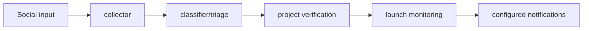

# Multichain Project Discovery

**Collect social observations, classify projects and track launch evidence.**

  [](LICENSE)

[Overview](#overview) · [Quickstart](#quickstart) · [Example](#example) · [Validation](#validation) · [Documentation](#documentation)

## Overview

A multi-stage Python discovery pipeline that collects social observations, classifies projects and tracks launch evidence.

**Stack:** Python · Redis Pub/Sub · SQLite WAL · Docker Compose · LLM API adapter · Telegram integrations

## Services form a discovery pipeline

| Component | Behavior |
| --- | --- |
| Collect and triage | Separate services collect observations and classify candidates. |
| Enrich and verify | Address extraction and project checks add chain/source context. |
| Track and route | Monitoring services persist state and route stage-specific summaries. |

## Processing path



## Quickstart

```console
python -m venv .venv
# Activate .venv, then:
python -m pip install -r project-agent/project-agent/requirements.txt
python -m compileall -q project-agent/project-agent/agent
```

The commands above install prerequisites or run the specified offline checks. Live collection, cloud operations, messaging and trading are separate operational steps when present.

## Example

**Inspect the workflow**

Start in the [main service README](project-agent/project-agent/README.md) and [flow guide](project-agent/project-agent/README_FLOW.md). Follow a social observation through collection, classification, verification and launch tracking. Read the queue and persistence boundaries before choosing individual services.

## Configuration and storage

Redis Pub/Sub routes service messages; SQLite WAL stores project/social state. Nested requirements/Compose definitions belong to their service tree. LLM, Telegram and source-session configuration are external inputs; Supabase integration code is also present.

## Repository guide

| Location | Responsibility |
| --- | --- |
| [project-agent/project-agent/agent](project-agent/project-agent/agent) | Main agent modules |
| [project-agent/project-agent/services](project-agent/project-agent/services) | Service implementations |
| [project-agent/project-agent/supabase_schema.sql](project-agent/project-agent/supabase_schema.sql) | Supabase schema |
| [rl-agent](rl-agent) | Alternate service tree |

## Validation

```console
python -m unittest discover -s tests -v
```

These checks use offline fixtures or controlled backends.

## Scope and operational boundaries

Multiple service-tree versions remain. The root guide identifies the main documented tree rather than claiming all versions are interchangeable. Existing notes identify batching, cookie handling and routing limitations; installing dependencies does not validate live integrations.

## Documentation

- [Main service guide](project-agent/project-agent/README.md)
- [Pipeline flow](project-agent/project-agent/README_FLOW.md)

## License and attribution

Project-authored source code is licensed under the [MIT License](LICENSE). Third-party components and datasets retain their respective rights and licenses.
