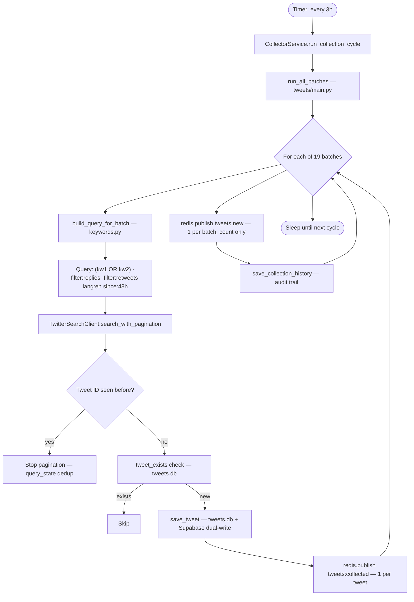

# FLOW-1: Keyword Collector

**Service:** `services/collector/main.py`  
**Core:** `tweets/batch_collector.py`, `tweets/api_client.py`, `tweets/keywords.py`  
**Verified against code** — docs wrong where noted.

---

## Overview

Runs every 3 hours. Searches Twitter for 19 keyword batches. Saves new tweets to `tweets.db`. Publishes to Redis for Stage 1 triage.

---

## Trigger

Timer-based: `COLLECTION_INTERVAL_HOURS` env (default `3`).  
[services/collector/main.py:56](../../services/collector/main.py#L56) — `time.sleep(interval_secs)`

---

## Config (all from env)

| Var | Default | Source |
|---|---|---|
| `COLLECTION_INTERVAL_HOURS` | `3` | [collector/main.py:24](../../services/collector/main.py#L24) |
| `MAX_PAGES_PER_BATCH` | `5` | [collector/main.py:25](../../services/collector/main.py#L25) |
| `TWITTER_API_KEY` | required | [tweets/api_client.py:10](../../tweets/api_client.py#L10) |
| `REDIS_URL` | `redis://localhost:6388` | [collector/main.py:19](../../services/collector/main.py#L19) |

---

## Flow Diagram

---

## Steps — Code Verified

### 1. Cycle start
[collector/main.py:38–60](../../services/collector/main.py#L38)  
`CollectorService.run()` → calls `run_collection_cycle()` every `COLLECTION_INTERVAL_HOURS`.

### 2. Batch iteration
[tweets/main.py:12–24](../../tweets/main.py#L12)  
`run_all_batches()` → calls `BatchCollector.collect_batch(name)` for each of 19 batches.

**19 batches** (docs say 18 — code has 19):
`pre_launch, launch_soon, launch_timing, launchpad, tech_terms, early_stage, token_signals, community, fresh_launches, new_projects, protocol_chains, new_on_chains, solana, megaeth, monad, bsc, ethereum, base, other_chains`  
[tweets/keywords.py:1–60](../../tweets/keywords.py#L1)

### 3. Query build
[tweets/keywords.py — `build_query_for_batch()`]  
Format: `("kw1" OR "kw2" ...) -filter:replies -filter:retweets lang:en since:{DATE}`  
`since` date = last 48 hours from run time.

### 4. Pagination with dedup
[tweets/api_client.py — `search_with_pagination()`]  
Stops when tweet ID matches last-seen ID stored in `query_state` table.  
Updates `query_state` after each successful run.

### 5. Save + dual-write
[tweets/database.py — `save_tweet()`]  
Saves to SQLite `tweets.db`. Fire-and-forget Supabase upsert. Non-blocking.

### 6. Publish per tweet
[collector/main.py:72–80](../../services/collector/main.py#L72)  
Publishes `tweets:collected` with full tweet dict for every new tweet.

### 7. Publish per batch
[collector/main.py:85–90](../../services/collector/main.py#L85)  
Publishes `tweets:new` once per batch with total count (triggers triage poll).

---

## DB Writes

| Table | DB | What |
|---|---|---|
| `tweets` | tweets.db | Full tweet row (50+ cols) |
| `query_state` | tweets.db | Newest tweet ID per query (dedup) |
| `collection_history` | tweets.db | Audit: batch name, count, duration |
| `tweets` (Supabase) | Supabase | Dual-write, non-blocking |

---

## Redis Published

| Channel | When | Consumer |
|---|---|---|
| `tweets:collected` | Every new tweet | telegram-low → #stage-0 |
| `tweets:new` | Every batch (count) | triage service |

---

## Known Issues / Bugs

None found in collector code itself.

> **Doc discrepancy:** `ARCHITECTURE.md` says 18 batches. Code has **19** (includes `other_chains`).  
> [tweets/keywords.py](../../tweets/keywords.py) is ground truth.
