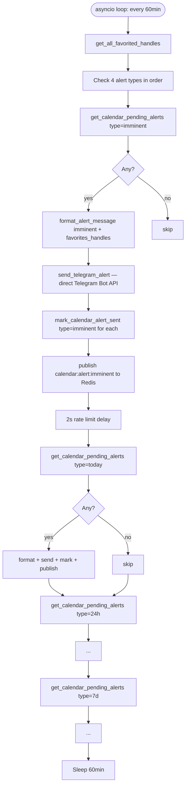

# FLOW-10: Calendar Alerter

**Service:** `services/calendar-alerter/main.py`  
**Verified against code.**

---

## Overview

Runs every 60 minutes (async). Checks `launch_calendar` table for upcoming launches. Sends grouped alerts directly to Telegram via Bot API (bypasses telegram-high service). Publishes `calendar:alert:{type}` to Redis for informational use.

---

## Trigger

`asyncio.sleep(CHECK_INTERVAL_MINUTES * 60)` — default 60 min.  
[calendar-alerter/main.py:39](../../services/calendar-alerter/main.py#L39)

---

## Config

| Var | Default | Source |
|---|---|---|
| `ALERT_CHECK_INTERVAL` | `60` (min) | [calendar-alerter/main.py:39](../../services/calendar-alerter/main.py#L39) |
| `TELEGRAM_BOT_TOKEN` | required | env |
| `TELEGRAM_ALERT_CHAT_ID` | required | env |
| `RATE_LIMIT_SECONDS` | `2.0` | [calendar-alerter/main.py:43](../../services/calendar-alerter/main.py#L43) |

> **Note:** Uses own separate `TELEGRAM_ALERT_CHAT_ID` — sends to different channel than telegram-high. Direct HTTP to Telegram API, does NOT go through telegram-high service.

---

## Flow Diagram

---

## Alert Types

| Type | Trigger window |
|---|---|
| `imminent` | Launch within hours |
| `today` | Launch today |
| `24h` | Launch within 24 hours |
| `7d` | Launch within 7 days |

Each type checked separately. Alert sent only once per project per type (tracked by `mark_calendar_alert_sent()`).

---

## Message Formatting

[calendar-alerter/main.py:169–275](../../services/calendar-alerter/main.py#L169)  
`format_alert_message(alert_type, projects, favorites_handles)`:

1. **FAVORITES section first** — projects in user's favorites list shown prominently at top
2. Grouped by chain with emojis
3. Per project: handle link, name, ticker, date, time remaining, platform
4. Possible tickers inferred from name if no confirmed ticker

**Time remaining:** calculated live from `launch_date` + `launch_time` fields.  
**Ticker inference:** if no confirmed ticker, generates `$NAME[:4]`, `$INITIALS`, `$NAME[:3]` suggestions.

---

## DB Reads

| Table | DB | Purpose |
|---|---|---|
| `launch_calendar` | agent.db | Pending alerts by type |
| `project_favorites` | agent.db | Favorited handles for FAVORITES section |

## DB Writes

| Table | DB | What |
|---|---|---|
| `launch_calendar` | agent.db | Mark `{type}_alert_sent=1` after sending |

---

## Redis Published

| Channel | When | Consumer |
|---|---|---|
| `calendar:alert:imminent` | Alert sent | informational only |
| `calendar:alert:today` | Alert sent | informational only |
| `calendar:alert:24h` | Alert sent | informational only |
| `calendar:alert:7d` | Alert sent | informational only |

---

## How launch_calendar Gets Populated

Calendar populated by two paths:
1. **Stage 2 verifier:** `CalendarAgent.analyze_and_save()` on project confirm — extracts launch date from LLM output
2. **Stage 3 monitor:** `save_to_calendar()` on `projects:alert` event — updates or adds launch date when monitor detects urgency
3. **Stage 3 monitor:** `update_calendar_status(handle, 'launched'/'cancelled')` — status updates
