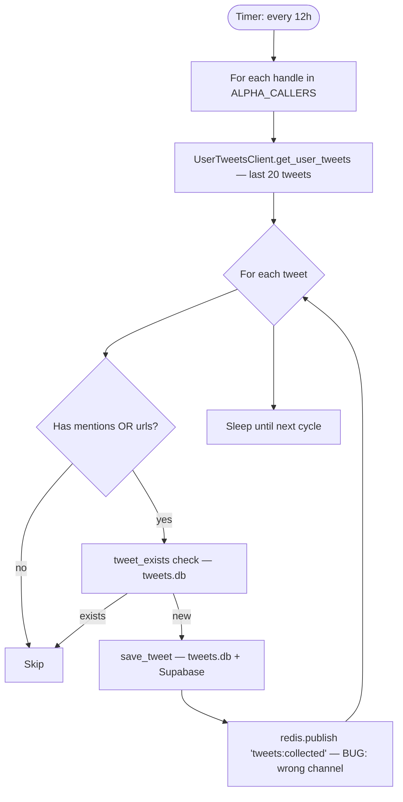

# FLOW-2: Alpha Hunter

**Service:** `services/alpha-hunter/main.py`  
**Verified against code** — confirmed bug documented below.

---

## Overview

Runs every 12 hours. Fetches recent tweets from curated list of "alpha callers" (influential crypto traders). Filters tweets that mention/link other projects. Saves to `tweets.db`. **BUG: publishes to wrong Redis channel.**

---

## Trigger

Timer-based: `HUNT_INTERVAL_HOURS` env (default `12`).

---

## Config

| Var | Default | Source |
|---|---|---|
| `HUNT_INTERVAL_HOURS` | `12` | [alpha-hunter/main.py:14](../../services/alpha-hunter/main.py#L14) |
| `TWEETS_PER_CALLER` | `20` | [alpha-hunter/main.py:15](../../services/alpha-hunter/main.py#L15) |
| `ALPHA_CALLERS` | `'AresLabs_xyz'` | [alpha-hunter/main.py:16](../../services/alpha-hunter/main.py#L16) |

`ALPHA_CALLERS` = comma-separated list of Twitter handles to hunt.

---

## Flow Diagram

---

## Steps — Code Verified

### 1. Cycle
[alpha-hunter/main.py:50–120](../../services/alpha-hunter/main.py#L50)  
Iterates `ALPHA_CALLERS.split(',')` — strips whitespace from each handle.

### 2. Fetch tweets
[alpha-hunter/main.py:65–80](../../services/alpha-hunter/main.py#L65)  
`UserTweetsClient.get_user_tweets()` — fetches up to `TWEETS_PER_CALLER` tweets per caller.

### 3. Filter: mentions or urls only
[alpha-hunter/main.py:90–100](../../services/alpha-hunter/main.py#L90)  
Skips tweets with no mentions AND no urls. Only shills/references pass.

### 4. Save + dual-write
`save_tweet()` in `tweets/database.py`. Marks `batch_name='alpha_hunter'`.

### 5. Publish — **BUG**
[alpha-hunter/main.py:107](../../services/alpha-hunter/main.py#L107)  
Publishes to `tweets:collected` (Stage 0 Telegram only).  
**Should publish to `tweets:new`** to trigger triage. Triage only subscribes to `tweets:new`.  
Alpha-hunter tweets **never reach Stage 1 triage via Redis** — only caught by triage's periodic 10s DB poll.

---

## DB Writes

| Table | DB | What |
|---|---|---|
| `tweets` | tweets.db | Full tweet (batch_name='alpha_hunter') |
| `tweets` (Supabase) | Supabase | Dual-write |

---

## Redis Published

| Channel | When | Consumer | Status |
|---|---|---|---|
| `tweets:collected` | Per new tweet | telegram-low only | **WRONG** — triage ignores this |

---

## Known Bugs

> **BUG (confirmed):** [alpha-hunter/main.py:107](../../services/alpha-hunter/main.py#L107)  
> Publishes `tweets:collected` instead of `tweets:new`.  
> Triage only subscribes to `tweets:new` — misses real-time notifications.  
> Mitigation: triage polls DB every 10s anyway — tweets still processed, just delayed.
