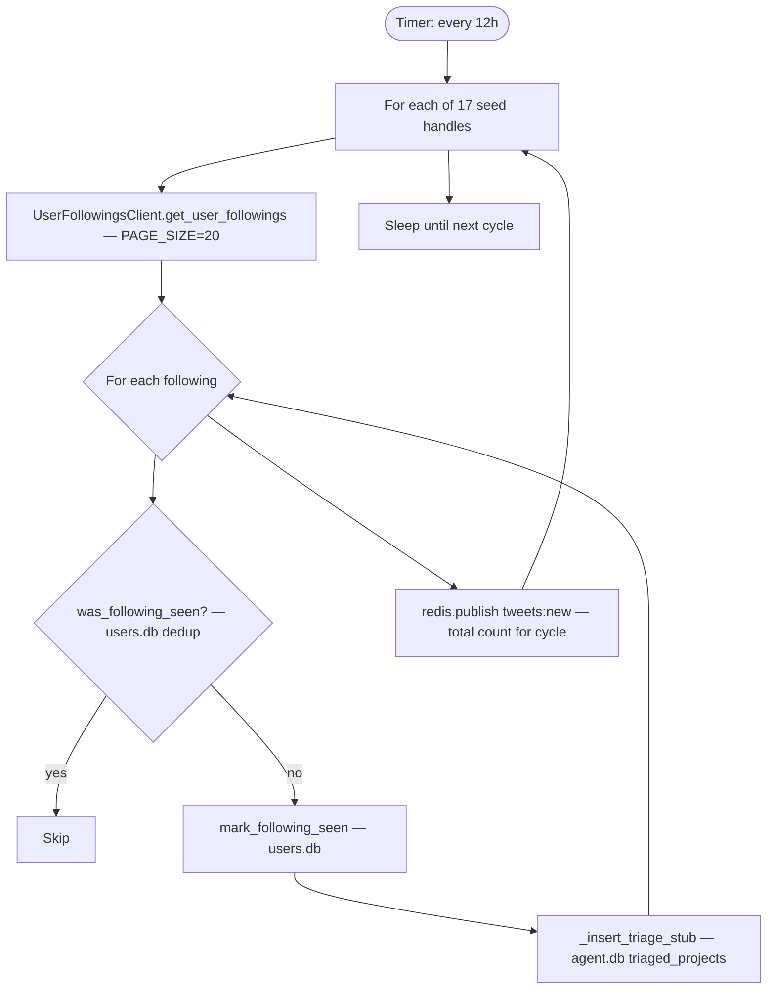

# FLOW-3: Alpha Followers

**Service:** `services/alpha-followers/main.py`  
**Core:** `users/api_client.py — UserFollowingsClient`  
**Verified against code.**

---

## Overview

Runs every 12 hours. Fetches Twitter followings of 17 hardcoded seed handles (known alpha traders). For each new account being followed, inserts a triage stub directly into `agent.db` — **bypasses Stage 1 LLM**. Publishes `tweets:new` to wake triage (which then processes stubs from DB).

---

## Trigger

Timer-based: `POLL_INTERVAL_HOURS` env (default `12`).

---

## Config

| Var | Default | Source |
|---|---|---|
| `POLL_INTERVAL_HOURS` | `12` | [alpha-followers/main.py:35](../../services/alpha-followers/main.py#L35) |
| `PAGE_SIZE` | `20` | [alpha-followers/main.py:36](../../services/alpha-followers/main.py#L36) |
| Seed handles | hardcoded 17 | [alpha-followers/main.py:40–58](../../services/alpha-followers/main.py#L40) |

**17 seed handles hardcoded** (not configurable via env):  
[alpha-followers/main.py:40–58](../../services/alpha-followers/main.py#L40)

---

## Flow Diagram

---

## Steps — Code Verified

### 1. Seed iteration
[alpha-followers/main.py:60–120](../../services/alpha-followers/main.py#L60)  
17 handles: `mikedemarais, cobie, 0xmons` + 14 others hardcoded at lines 40–58.

### 2. Fetch followings
[users/api_client.py — `UserFollowingsClient.get_user_followings()`]  
Endpoint: `GET /twitter/user/followings` with `page_size=20`.  
Cursor-paginated. Stops on already-seen cursor or empty result.

### 3. Dedup check
[users/database.py — `was_following_seen(seed_handle, user_id)`]  
Checks `alpha_followings` table in `users.db`.

### 4. Insert triage stub — bypasses LLM
[alpha-followers/main.py — `_insert_triage_stub()`]  
Inserts directly into `triaged_projects` table with:
- `discovery_source = 'alpha_followers'`
- `discovery_keyword = '@{seed_handle}'`
- Minimal data (handle, author_id, followers from API)

No classifier LLM call. No CA check. Goes straight to Stage 2 queue.

### 5. Publish batch notification
[alpha-followers/main.py — end of cycle]  
Publishes count to `tweets:new` once per full cycle (not per account).  
Wakes triage's Redis subscriber to poll DB for new items.

---

## DB Writes

| Table | DB | What |
|---|---|---|
| `alpha_followings` | users.db | Dedup — seed+following combos seen |
| `triaged_projects` | agent.db | Triage stub (discovery_source='alpha_followers') |

---

## Redis Published

| Channel | When | Consumer |
|---|---|---|
| `tweets:new` | End of cycle (total count) | triage service |

---

## Notes

- Alpha-followers stubs **skip Stage 1 LLM** — enter pipeline at Stage 2 verifier
- Quality gate = "is this handle followed by a known alpha trader?"
- No website or tweet analysis at injection point — verifier does full analysis
- If same following appears across multiple seeds, first one wins (dedup by user_id)
