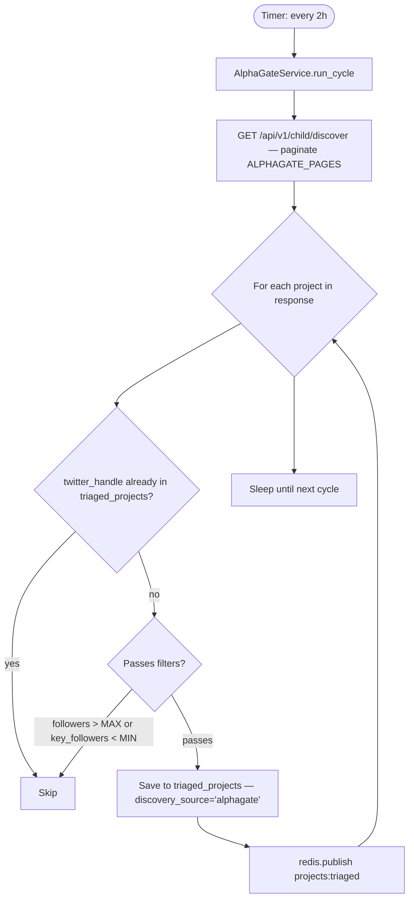

# FLOW-4: AlphaGate VIP Bypass

**Service:** `services/alphagate/main.py`  
**Client:** `agent/alphagate_client.py`  
**Verified against code** — confirmed bug documented below.

---

## Overview

Runs every 2 hours. Calls AlphaGate API to fetch pre-filtered high-signal crypto projects. Saves directly to `triaged_projects` — **bypasses Stage 1 LLM entirely**. Publishes to `projects:triaged` to trigger Stage 2 verification.

---

## Trigger

Timer-based: `ALPHAGATE_INTERVAL_HOURS` env (default `2`).

---

## Config

| Var | Default | Source |
|---|---|---|
| `ALPHAGATE_INTERVAL_HOURS` | `2` | [alphagate/main.py:25](../../services/alphagate/main.py#L25) |
| `ALPHAGATE_MAX_FOLLOWERS` | `50000` | [alphagate/main.py:26](../../services/alphagate/main.py#L26) |
| `ALPHAGATE_MIN_KEY_FOLLOWERS` | `1` | [alphagate/main.py:27](../../services/alphagate/main.py#L27) |
| `ALPHAGATE_PAGES` | `5` | [alphagate/main.py:28](../../services/alphagate/main.py#L28) |
| `ALPHAGATE_LIMIT` | `60` | [alphagate/main.py:29](../../services/alphagate/main.py#L29) |
| `ALPHAGATE_COOKIES` | **hardcoded** | [alphagate/main.py:60–63](../../services/alphagate/main.py#L60) |

---

## Flow Diagram



---

## Steps — Code Verified

### 1. Fetch from AlphaGate API
[alphagate/main.py:45–90](../../services/alphagate/main.py#L45)  
URL: `https://api.alphagate.io/api/v1/child/discover`  
Paginates up to `ALPHAGATE_PAGES` pages × `ALPHAGATE_LIMIT` per page.  
Authentication: hardcoded cookie strings (see Bug below).

### 2. Filters applied
- `followers <= ALPHAGATE_MAX_FOLLOWERS` (50k cap)
- `key_followers_count >= ALPHAGATE_MIN_KEY_FOLLOWERS` (1 min)

### 3. Dedup
Checks `triaged_projects.twitter_handle` (UNIQUE constraint).  
On conflict: skip (not upsert).

### 4. Save — bypasses LLM
Inserts into `triaged_projects` with:
- `discovery_source = 'alphagate'`
- `discovery_keyword = '<alphagate_category>'`
- Key-follower count, alpha-hunter data included

### 5. Publish — triggers verifier
[alphagate/main.py:105](../../services/alphagate/main.py#L105)  
`projects:triaged` published per new project. Verifier subscribes to this.

---

## AlphaGate Enrichment Client

`agent/alphagate_client.py` — used by **verifier** and **monitor** (not just this service):

Three endpoints:
| Endpoint | Data |
|---|---|
| `GET /child/alerts` | Bio/username change alerts |
| `GET /child/first-followers` | Key followers who followed early |
| `GET /child/parents` | Alpha hunters who track this project |

`AlphaGateClient.enrich_project(handle, twitter_id)` calls all 3, merges into:
```python
{
  "found_in_alphagate": bool,
  "key_followers": list,
  "key_followers_count": int,
  "alpha_hunters": list,
  "alpha_hunters_count": int,
  "best_hunter_winrate": float,
  "alerts": list,
  "alerts_summary": {"bio_changes": int, "username_changes": int}
}
```

Retry with backoff on 5xx: 3s / 6s / 9s.  
[alphagate_client.py:35](../../agent/alphagate_client.py#L35) — **COOKIES hardcoded here too.**

---

## DB Writes

| Table | DB | What |
|---|---|---|
| `triaged_projects` | agent.db | Full project row (discovery_source='alphagate') |

---

## Redis Published

| Channel | When | Consumer |
|---|---|---|
| `projects:triaged` | Per new project | verifier, telegram-low |

---

## Known Bugs

> **BUG (confirmed):** [alphagate/main.py:60–63](../../services/alphagate/main.py#L60) and [alphagate_client.py:35–38](../../agent/alphagate_client.py#L35)  
> AlphaGate cookies/tokens **hardcoded** in source. Not read from env vars.  
> Fix: move to `ALPHAGATE_COOKIES` env var.  
> Risk: cookies rotate → entire AlphaGate pipeline stops working without code change.
