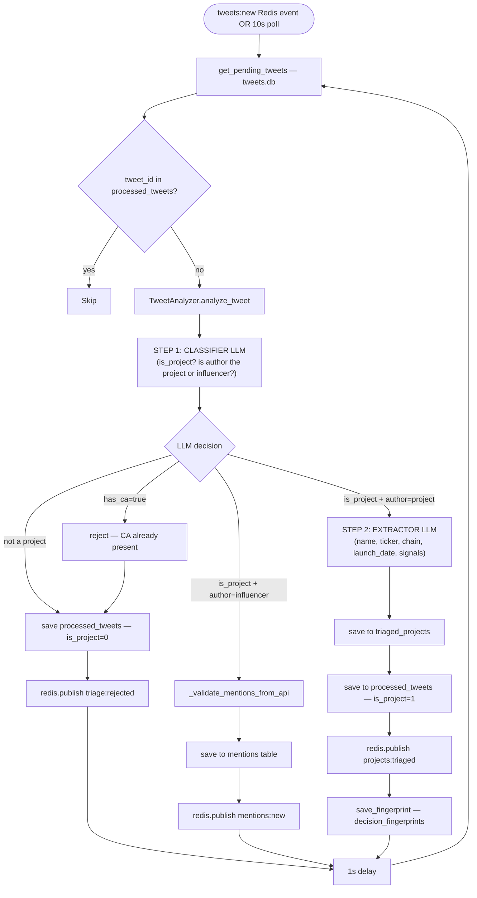

# FLOW-5: Stage 1 — Triage

**Service:** `services/triage/main.py`  
**Core logic:** `agent/analyzer.py — TweetAnalyzer`  
**Verified against code** — significant doc discrepancy noted.

---

## Overview

Continuously running. Listens for `tweets:new` Redis events + polls DB every 10s. For each unprocessed tweet, runs a 2-step LLM pipeline to decide: reject, save mention, or save as triaged project.

---

## Trigger

Dual-trigger (both active simultaneously):
1. Redis subscription to `tweets:new` → polls DB immediately
2. Periodic DB poll every `POLL_INTERVAL=10` seconds  
[triage/main.py:24](../../services/triage/main.py#L24) — `POLL_INTERVAL = 10`

---

## Config

| Var | Default | Source |
|---|---|---|
| `POLL_INTERVAL` | `10` | [triage/main.py:24](../../services/triage/main.py#L24) |
| `BATCH_SIZE` | `999999` | [triage/main.py:24](../../services/triage/main.py#L24) |
| `DELAY_BETWEEN_TWEETS` | `1.0` | [triage/main.py:25](../../services/triage/main.py#L25) |
| `REDIS_URL` | `redis://localhost:6388` | [triage/main.py:18](../../services/triage/main.py#L18) |

`BATCH_SIZE=999999` means ALL pending tweets processed each cycle (no limit in practice).

---

## Flow Diagram



---

## Steps — Code Verified

### 1. Get pending tweets
[triage/main.py:165–170](../../services/triage/main.py#L165)  
`get_pending_tweets()` returns tweets from `tweets.db` NOT yet in `processed_tweets` (agent.db).  
Cross-DB join via shared volume path.

### 2. Step 1 — Classifier LLM
[agent/analyzer.py:45–90](../../agent/analyzer.py#L45)  
Calls `OpenRouterClient.chat()` with classifier system prompt.  
Model: `google/gemini-2.5-flash-lite` (OpenRouter)  
`response_format: {"type": "json_object"}` enforced.

**Classifier output fields:**
```json
{
  "is_project": bool,
  "author_is_project": bool,
  "has_ca": bool,
  "confidence": float,
  "rejection_reason": str
}
```

> **Doc discrepancy (CRITICAL):** `ARCHITECTURE.md` claims `ca_detector.py` regex runs BEFORE LLM.  
> **Code reality:** `has_ca` comes from classifier LLM response only in Stage 1.  
> `ca_detector.py` regex is used only in Stage 2 (verifier), NOT Stage 1.  
> [agent/analyzer.py — no import of ca_detector](../../agent/analyzer.py)

### 3. Mention validation (DEC-004)
[agent/analyzer.py:90–133](../../agent/analyzer.py#L90)  
`_validate_mentions_from_api()` overrides LLM mention decisions using `entities.user_mentions` from Twitter API payload.  
If author classified as influencer, checks real entities to find mentioned project handles.  
Prevents LLM hallucinating mentioned accounts.

### 4. 4-Case decision tree
[triage/main.py:182–220](../../services/triage/main.py#L182)

| Case | Condition | Action |
|---|---|---|
| Reject | `is_project=False` | → `processed_tweets`, publish `triage:rejected` |
| Reject (CA) | `has_ca=True` | → `processed_tweets` (rejected), publish `triage:rejected` |
| Mention | `is_project=True`, `author_is_project=False` | → `mentions` table, publish `mentions:new` |
| Accept | `is_project=True`, `author_is_project=True` | → Step 2 (Extractor LLM) |

### 5. Step 2 — Extractor LLM (only on Accept)
[agent/analyzer.py:135–200](../../agent/analyzer.py#L135)  
Extracts structured data from approved tweet:
```json
{
  "project_name": str,
  "project_ticker": str,
  "project_chain": str,
  "project_type": str,
  "launch_date": str,
  "launch_platform": str,
  "has_website": bool,
  "website_url": str,
  "has_telegram": bool,
  "telegram_url": str,
  "keywords_found": list
}
```

### 6. Save results
- `triaged_projects` table: project row with `twitter_handle` as UNIQUE key
- `processed_tweets` table: marks tweet processed (dedup for future runs)
- `decision_fingerprints` table: full audit (decision, confidence, reason, raw LLM response)

---

## DB Reads

| Table | DB | Purpose |
|---|---|---|
| `tweets` | tweets.db | Source tweets to analyze |
| `processed_tweets` | agent.db | Dedup — skip already analyzed |

## DB Writes

| Table | DB | What |
|---|---|---|
| `processed_tweets` | agent.db | Every tweet outcome |
| `triaged_projects` | agent.db | Accepted projects |
| `mentions` | agent.db | Influencer-mentioned handles |
| `decision_fingerprints` | agent.db | Full audit trail |
| `triaged_projects` (Supabase) | Supabase | Dual-write |

---

## Redis

| Channel | Subscribed | Published |
|---|---|---|
| `tweets:new` | ✅ Subscribe | — |
| `triage:rejected` | — | ✅ Per rejected tweet |
| `mentions:new` | — | ✅ Per mention saved |
| `projects:triaged` | — | ✅ Per accepted project |
| `fingerprint:new` | — | ✅ Per decision |

---

## Known Bugs / Notes

> **BATCH_SIZE=999999 at [triage/main.py:24](../../services/triage/main.py#L24)** — intended to process all, but could spike memory if backlog grows large.

> **1s delay between tweets** at [triage/main.py:25](../../services/triage/main.py#L25) — rate-limits LLM calls. 1000 tweets = 17min.
