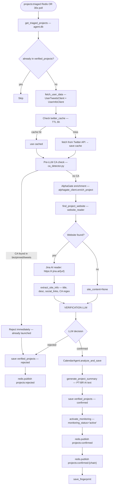

# FLOW-6: Stage 2 — Verification

**Service:** `services/verifier/main.py`  
**Core logic:** `agent/verifier.py — ProjectVerifier`  
**Verified against code.**

---

## Overview

Continuously running. Listens for `projects:triaged` Redis events + polls DB every 30s. For each unverified project, runs full profile analysis: Twitter data, AlphaGate enrichment, website scraping, LLM decision. Confirmed projects enter Stage 3 monitoring.

---

## Trigger

Dual-trigger:
1. Redis subscription to `projects:triaged`
2. Periodic DB poll every `POLL_INTERVAL=30` seconds  
[verifier/main.py:POLL_INTERVAL](../../services/verifier/main.py)

---

## Config

| Var | Default | Source |
|---|---|---|
| `POLL_INTERVAL` | `30` | verifier/main.py |
| `BATCH_SIZE` | `999999` | verifier/main.py |
| `DELAY_BETWEEN_PROJECTS` | `2.0s` | verifier/main.py |

---

## Flow Diagram



---

## Steps — Code Verified

### 1. Fetch Twitter data (cached)
[agent/verifier.py:80–150](../../agent/verifier.py#L80)  
`get_or_fetch_user_tweets()` + `get_or_fetch_user_info()` — both use `twitter_cache` in `users.db`.  
TTL = 6 hours. Key = `id:{author_id}` or `handle:{username}`.  
Fetches pinned tweet — marked `_is_pinned=True` in tweet object.

### 2. Pre-LLM CA check — **BEFORE LLM**
[agent/verifier.py:160–205](../../agent/verifier.py#L160)  
`is_project_launched(bio, tweet_texts, pin_tweet_text)` from `ca_detector.py`.  
Patterns checked:
- EVM: `0x[a-fA-F0-9]{40}`
- Solana: `[1-9A-HJ-NP-Za-km-z]{32,44}`
- BTC legacy + segwit (`bc1...`)
- TRON: `T[a-zA-HJ-NP-Z0-9]{33}`
- TON: `[EU]Q...` prefix
- CA prefix patterns (`ca:`, `contract:`, etc.)

Checks: bio + pinned tweet + first 10 tweets.  
If found → immediate reject (no LLM call, saves cost).

### 3. AlphaGate enrichment
[agent/verifier.py:210–240](../../agent/verifier.py#L210)  
`AlphaGateClient.enrich_project(handle, twitter_id)` — 3 endpoints, no cache.  
Adds key-follower count, alpha-hunter data to context.

### 4. Website fetch
[agent/website_reader.py — `find_project_website()`]  
Priority: bio URLs first, then tweet URLs.  
Excludes: twitter.com, t.co, instagram.com, tiktok.com, youtube.com, professional-network domains, discord.gg, t.me.  
Reads via Jina AI: `https://r.jina.ai/{url}` (proxy that converts any URL to markdown).

`extract_site_info()` via regex:
- `title`: first markdown `#` header
- `description`: first paragraph
- `social_links`: matches to known platforms
- `contract_found`: EVM first, Solana fallback regex

### 5. Verification LLM
[agent/verifier.py:260–340](../../agent/verifier.py#L260)  
Full context: Twitter profile + 10–20 tweets + site content + AlphaGate data.  
Prompt includes date context (today's date injected).

Output:
```json
{
  "verification_status": "confirmed" | "rejected",
  "rejection_reason": str,
  "confidence": float,
  "project_name": str,
  "project_ticker": str,
  "project_chain": str,
  "launch_date": str,
  "launch_platform": str,
  "site_analysis": {
    "has_whitepaper": bool,
    "has_tokenomics": bool,
    "has_roadmap": bool,
    "has_team": bool,
    "has_audit": bool
  }
}
```

### 6. On confirmed: post-processing
[verifier/main.py:150–195](../../services/verifier/main.py#L150)

**Order is:** CalendarAgent → PT-BR summary → DB save → Redis publish.

`CalendarAgent.analyze_and_save()` extracts launch date if mentioned and saves to `launch_calendar`.  
`generate_project_summary()` — calls LLM again for PT-BR human-readable summary for Telegram.

### 7. Publish
[verifier/main.py:200–215](../../services/verifier/main.py#L200)  
Publishes `projects:confirmed` (for telegram-high + monitor).  
Then `projects:confirmed:{chain}` using `get_chain_group(chain)` from `chain_utils.py`.

---

## DB Reads

| Table | DB | Purpose |
|---|---|---|
| `triaged_projects` | agent.db | Input queue |
| `verified_projects` | agent.db | Dedup check |
| `twitter_cache` | users.db | TTL cache for user data |

## DB Writes

| Table | DB | What |
|---|---|---|
| `verified_projects` | agent.db | Full verification result |
| `launch_calendar` | agent.db | Parsed launch date (if confirmed) |
| `decision_fingerprints` | agent.db | Audit trail |
| `verified_projects` (Supabase) | Supabase | Dual-write |

---

## Redis

| Channel | Sub/Pub | Consumer |
|---|---|---|
| `projects:triaged` | Subscribe | — |
| `projects:confirmed` | Publish | monitor, telegram-high |
| `projects:confirmed:{chain}` | Publish | telegram-chains (ALL channel) |
| `projects:rejected` | Publish | telegram-high |
| `fingerprint:new` | Publish | telegram-low |

---

## Chain Mapping

`get_chain_group(chain)` from [agent/chain_utils.py](../../agent/chain_utils.py):
- `sol/solana` → `solana`
- `base` → `base`
- `eth/ethereum` → `ethereum`
- `bsc/bnb/binance` → `bsc`
- `monad` → `monad`
- `megaeth` → `megaeth`
- anything else → `other`
