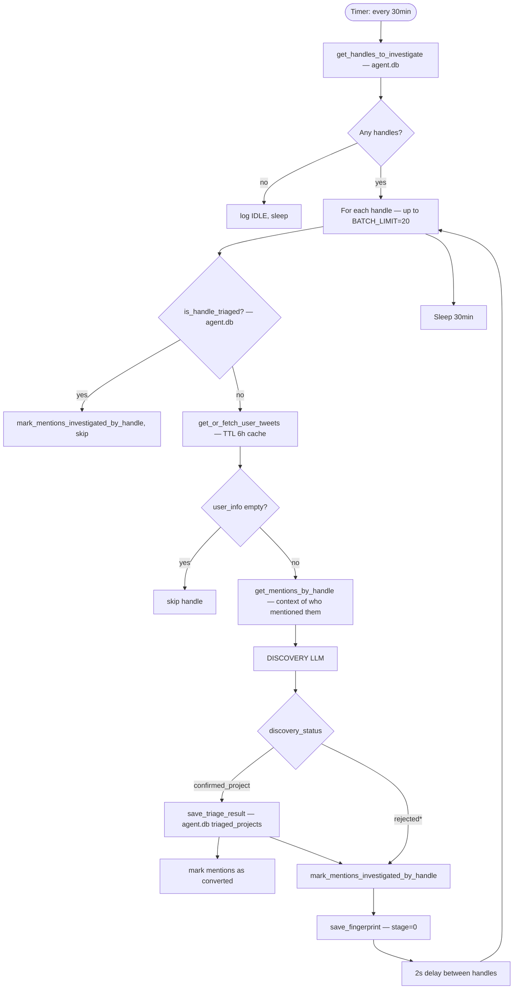

# FLOW-8: Discovery Pipeline

**Service:** `services/discoverer/main.py`  
**Core logic:** `agent/discoverer.py — ProjectDiscoverer`  
**Verified against code.**

---

## Overview

Runs every 30 minutes. Takes handles saved in `mentions` table (from Stage 1 triage when influencer mentions a project handle). Fetches their Twitter profile and tweets. Runs LLM to decide if handle is a real pre-launch project. Confirmed handles are saved as triage stubs → enter Stage 2.

---

## Trigger

Timer-based: `DISCOVERY_INTERVAL` env (default `1800s = 30min`).  
[discoverer/main.py:24](../../services/discoverer/main.py#L24)

---

## Config

| Var | Default | Source |
|---|---|---|
| `DISCOVERY_INTERVAL` | `1800` (30min) | [discoverer/main.py:24](../../services/discoverer/main.py#L24) |
| `MIN_MENTIONS` | `1` | [discoverer/main.py:25](../../services/discoverer/main.py#L25) |
| `BATCH_LIMIT` | `20` | [discoverer/main.py:26](../../services/discoverer/main.py#L26) |

`MIN_MENTIONS=1` means any handle mentioned at least once gets investigated.

---

## Flow Diagram



---

## Steps — Code Verified

### 1. Get handles to investigate
[agent/database.py — `get_handles_to_investigate(min_mentions, limit)`]  
Returns handles from `mentions` table where:
- `investigated = 0`
- `mention_count >= MIN_MENTIONS`

### 2. Already triaged check
[agent/discoverer.py:157](../../agent/discoverer.py#L157)  
`is_handle_triaged(handle)` — checks both `triaged_projects` and `verified_projects`.  
If already there: marks mentions investigated, skips LLM.

### 3. Fetch Twitter data
[agent/discoverer.py:166–188](../../agent/discoverer.py#L166)  
`get_or_fetch_user_tweets()` — fetches up to 15 tweets (TTL 6h cache).  
Derives `user_info` from first tweet's `author` field.  
If `user_info` missing followers: tries `get_or_fetch_user_info()` separately.

### 4. Mentions context
[agent/discoverer.py:198–201](../../agent/discoverer.py#L198)  
Builds text showing who mentioned this handle and what they said.  
Shows up to 5 example mentions.

### 5. Discovery LLM
[agent/discoverer.py:230](../../agent/discoverer.py#L230)  
System prompt: `DISCOVERY_SYSTEM_PROMPT` (inline in discoverer.py, NOT in prompts.py).  
User prompt: `DISCOVERY_USER_PROMPT` — formatted with handle, profile, tweets, mentions context.

Output:
```json
{
  "discovery_status": "confirmed_project" | "rejected_not_project" | "rejected_influencer" | "rejected_launched" | "pending",
  "confidence": float,
  "rejection_reason": str,
  "project": {
    "name": str,
    "ticker": str,
    "chain": str,
    "type": str,
    "has_ca": bool,
    "name_possibilities": [...],
    "ticker_possibilities": [...]
  },
  "launch": {"status": str, "date": str, "platform": str},
  "signals": {"has_website": bool, "website_url": str, ...}
}
```

### 6. On confirmed — save as triage
[agent/discoverer.py:296–325](../../agent/discoverer.py#L296)  
Calls `save_triage_result()` with minimal source info:
```python
{
  "source": {
    "discovery_source": "manual_add",  # note: uses 'manual_add' not 'discovery'
    "tweet_text_preview": f"Discovered via {len(mentions)} mentions"
  }
}
```
Saved handle enters Stage 2 verifier queue via `triaged_projects`.

### 7. Fingerprint
[agent/discoverer.py:259–293](../../agent/discoverer.py#L259)  
Saved with `stage=0` — discovery is considered pre-Stage-1.

---

## DB Reads

| Table | DB | Purpose |
|---|---|---|
| `mentions` | agent.db | Handles to investigate |
| `triaged_projects` | agent.db | Already-processed check |
| `verified_projects` | agent.db | Already-processed check |
| `twitter_cache` | users.db | Cached tweet data |

## DB Writes

| Table | DB | What |
|---|---|---|
| `triaged_projects` | agent.db | Confirmed projects (→ enters Stage 2) |
| `mentions` | agent.db | Mark investigated + converted |
| `decision_fingerprints` | agent.db | Discovery audit (stage=0) |

---

## Redis Published

| Channel | When | Consumer |
|---|---|---|
| `discovery:complete` | Per investigated handle | telegram-high #mentions |

> Note: only the service (`discoverer/main.py`) publishes `discovery:complete`.  
> [discoverer/main.py:43–58](../../services/discoverer/main.py#L43) — only publishes for confirmed + some rejections.

---

## Pipeline Position

Discoverer is fed by Stage 1 (mentions) and feeds Stage 2 (triaged_projects):

```
Stage 1 (triage)
  → mentions table
      → Discoverer (30min poll)
          → triaged_projects
              → Stage 2 (verifier)
```
