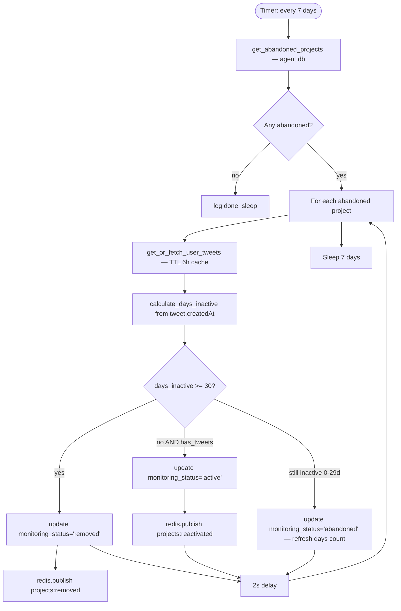

# FLOW-9: Abandoned Checker

**Service:** `services/abandoned-checker/main.py`  
**Verified against code.**

---

## Overview

Runs every 7 days. Fetches all projects with `monitoring_status='abandoned'` (set by Stage 3 monitor when inactive 30+ days). Checks latest tweet date for each. Either removes (30+ days silent), reactivates (posted recently), or leaves as still-abandoned.

---

## Trigger

Timer-based: `CHECK_INTERVAL_DAYS` env (default `7` days).  
[abandoned-checker/main.py:27](../../services/abandoned-checker/main.py#L27)

---

## Config

| Var | Default | Source |
|---|---|---|
| `CHECK_INTERVAL_DAYS` | `7` | [abandoned-checker/main.py:27](../../services/abandoned-checker/main.py#L27) |
| `DAYS_TO_REMOVE` | `30` (hardcoded) | [abandoned-checker/main.py:28](../../services/abandoned-checker/main.py#L28) |

---

## Flow Diagram

---

## Steps — Code Verified

### 1. Get abandoned projects
[abandoned-checker/main.py:43–58](../../services/abandoned-checker/main.py#L43)  
Direct SQL: `SELECT ... FROM verified_projects WHERE monitoring_status = 'abandoned'`

### 2. Fetch latest tweet
[abandoned-checker/main.py:60–85](../../services/abandoned-checker/main.py#L60)  
`get_or_fetch_user_tweets()` — same TTL-6h cache as other services.  
Returns latest tweet date from `tweets[0].createdAt`.

### 3. Days calculation
[abandoned-checker/main.py:87–107](../../services/abandoned-checker/main.py#L87)  
`calculate_days_inactive(last_tweet_at)` — parses Twitter date format `"%a %b %d %H:%M:%S %z %Y"` then falls back to ISO.  
If parse fails → returns `999` (treated as 30+ days → remove).

### 4. Decision
[abandoned-checker/main.py:179–204](../../services/abandoned-checker/main.py#L179)

| Condition | Action | Redis |
|---|---|---|
| `days >= 30` | `monitoring_status = 'removed'` | `projects:removed` |
| `days < 30 AND has_tweets` | `monitoring_status = 'active'` | `projects:reactivated` |
| `days < 30 AND no tweets` | `monitoring_status = 'abandoned'` (update days) | none |

---

## DB Reads

| Table | DB | Purpose |
|---|---|---|
| `verified_projects` | agent.db | All abandoned projects |
| `twitter_cache` | users.db | Cached tweet data |

## DB Writes

| Table | DB | What |
|---|---|---|
| `verified_projects` | agent.db | Update `monitoring_status`, `inactive_days`, `last_tweet_at` |

---

## Redis Published

| Channel | When | Consumer |
|---|---|---|
| `projects:removed` | 30+ days inactive | telegram-high #stage-3 |
| `projects:reactivated` | Posted again | telegram-high #stage-3 |

---

## Relationship to Stage 3

Stage 3 monitor sets `monitoring_status='abandoned'` when `days_inactive >= 30`.  
Abandoned checker runs weekly to:
1. Escalate truly dead projects to `removed`
2. Recover reactivated projects back to active monitoring
